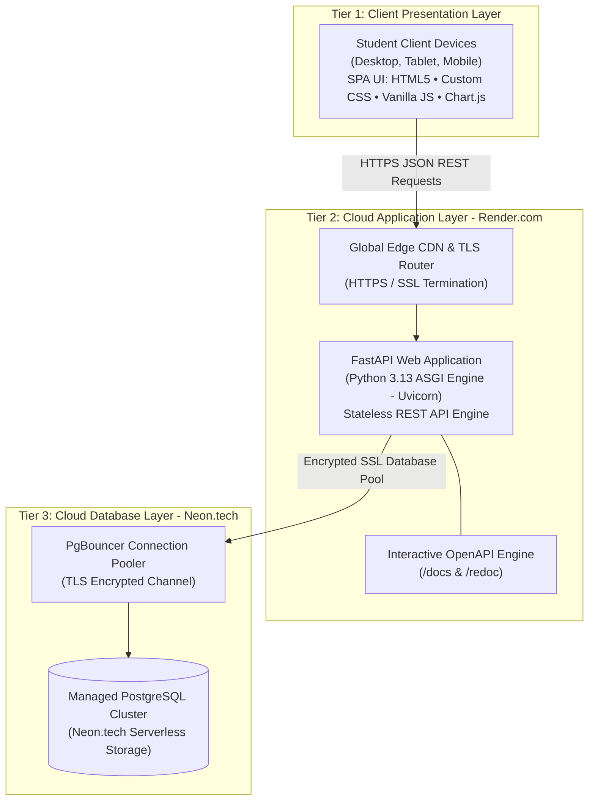
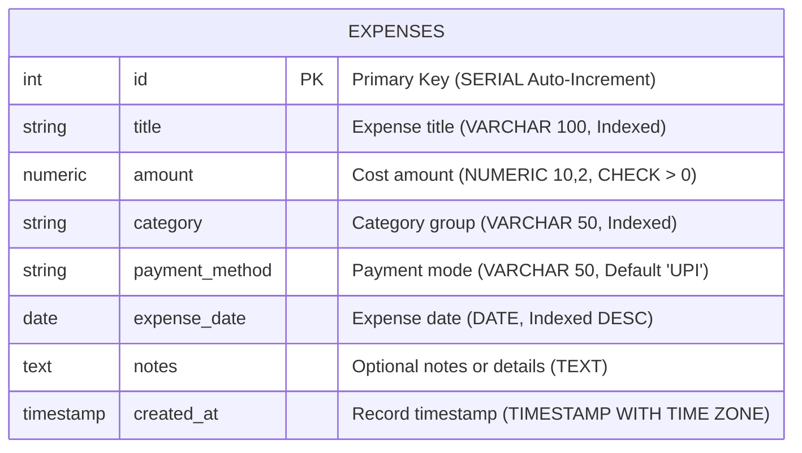

# BACSE344 — Cloud Infrastructure and Architecture
## Digital Assignment Submission Report

---

**Course Title:** BACSE344 — Cloud Infrastructure and Architecture  
**Academic Slot:** C1 Slot  
**Course Faculty:** Dr. P. Anandan  
**Student Name:** Sanskar  
**Registration Number:** 25BCE5808  
**Degree / Branch:** B.Tech — Computer Science and Engineering  
**Academic Year:** 2025 – 2026  

---

### Project & Submission URLs
- **Project Title:** CampusSpend — Cloud-Native Student Expense & Budget Tracker
- **Source Code Repository (GitHub):** [https://github.com/s-nsk-r/Campus-Spend](https://github.com/s-nsk-r/Campus-Spend)
- **Production Web Application (Render PaaS):** [https://campus-spend.onrender.com](https://campus-spend.onrender.com)
- **Interactive Swagger API Documentation:** [https://campus-spend.onrender.com/docs](https://campus-spend.onrender.com/docs)
- **ReDoc API Documentation:** [https://campus-spend.onrender.com/redoc](https://campus-spend.onrender.com/redoc)
- **Demonstration Video Link:** `[Insert Your Video Link Here (YouTube / Google Drive)]`

---

## Executive Summary

**CampusSpend** is a full-stack, cloud-native student expense tracking and personal finance management platform. Engineered following the principles of a decoupled **3-Tier Cloud Architecture**, the system addresses the common student challenge of financial fragmentation and volatile daily spending in university campuses and hostels.

The platform is deployed in a multi-cloud production environment:
1. **Presentation Layer:** High-performance Single Page Application (SPA) designed as a modern ACRU-inspired fintech Bento Grid with real-time responsive analytics.
2. **Application Layer (PaaS):** Stateless RESTful backend engine built with **FastAPI** (Python 3.13) hosted on **Render.com** with automated continuous integration and continuous deployment (CI/CD) from GitHub.
3. **Data Layer (DBaaS):** Serverless relational cloud database hosted on **Neon.tech PostgreSQL** with PgBouncer connection pooling, SSL/TLS transport encryption, and an offline-resilient local fallback.

---

## Evaluation Component 1: Problem Selection & System Architecture (1 Mark)

### 1.1 Real-World Problem Identification
University students, especially hostellers, face unique financial tracking challenges:
- High frequency of micro-transactions (mess food, snacks, laundry, local transport, stationery, textbooks).
- Disorganized expenditure across multiple payment channels (UPI, cash, debit cards, net banking).
- Lack of visibility into monthly budget ceilings, leading to unexpected end-of-month deficits.
- Existing commercial banking applications are overly complex, cluttered with ads, and lack student-centric categorization and dynamic budget allocation.

**CampusSpend** solves these problems by providing an intuitive, ad-free, cloud-accessible dashboard that calculates real-time spending velocity, automatically scales category budgets against an overall monthly spending ceiling, and visually monitors financial health.

---

### 1.2 3-Tier Cloud Architecture Model

The system follows a classic **3-Tier Cloud Architecture** designed for high availability, fault tolerance, and stateless compute scalability:



### 1.3 Cloud Tier Breakdown & Services Used

| Tier | Cloud Service / Technology | Role in Architecture | Key Cloud Capabilities |
| :--- | :--- | :--- | :--- |
| **Tier 1: Presentation** | Client Web Browsers / Mobile | Delivers responsive UI to students across any device | Asynchronous `fetch()` calls, zero page-reloads, sub-second DOM updates |
| **Tier 2: Compute (PaaS)** | **Render.com Web Service** | Hosts the containerized FastAPI backend application | Automated Git CI/CD, SSL termination, health-check monitoring, rolling deployments |
| **Tier 3: Data (DBaaS)** | **Neon.tech Serverless PostgreSQL** | Cloud-managed relational persistent storage | Automated backups, point-in-time recovery, compute-storage separation, connection pooling |
| **Edge & Security** | Global Cloudflare/Render Edge Router | Manages DNS, DDoS mitigation, and TLS 1.3 encryption | Automated HTTPS certificate management and low-latency edge routing |

### 1.4 Cloud Computing Concepts Applied
1. **Stateless Compute Execution:** The application server stores zero session state in local memory or local disk. All persistence resides in Neon PostgreSQL, allowing compute instances to be spun up, destroyed, or horizontally scaled without session loss.
2. **12-Factor App Configuration:** Database connection strings, port bindings, and runtime versions are injected via cloud environment variables (`DATABASE_URL`, `PORT`, `PYTHON_VERSION`).
3. **Continuous Deployment (CI/CD):** Every commit pushed to GitHub automatically triggers a build and zero-downtime rolling deployment on Render.
4. **Resilience & Health Probes:** A dedicated `/health` endpoint allows cloud orchestrators to automatically detect container crashes and restart unhealthy nodes.

---

## Evaluation Component 2: Application Development & Full CRUD Implementation (3 Marks)

### 2.1 User Interface & Modern Fintech Bento Grid
The frontend was engineered from scratch with a custom design system inspired by modern fintech dashboards (such as ACRU):
- **Hero Balance & Spending Card:** Displays total monthly spend, active budget limit, remaining balance, and live savings rate.
- **7-Category Daily Stacked Bar Chart:**
  - Tracks expenses over the 7 days of the week across 7 student categories (*Food & Dining, Academics & Books, Transportation, Hostel & Utilities, Entertainment, Healthcare, Others*).
  - Uses custom **1px hairline category dividers** with borderless baselines and tops for razor-sharp visual clarity.
- **Dynamic Category Budget Scaling:**
  - Rather than hardcoded static limits, category budgets automatically recalculate and scale proportionally whenever the student adjusts their monthly spending limit.
- **Financial Health Radial Gauge:**
  - Displays real-time **Budget Used** percentage.
  - Features an intuitive color threshold: signature lime-green when spending is safe, switching to solid red when 100% of the budget is exceeded, with remaining budget shown in neutral grey.
- **Segmented Cost Analysis Bar:**
  - A perfectly level, uncrooked segmented pill bar with crisp 2px slice spacing that visually shows proportional category spend.
- **Dual-Theme Engine:**
  - **Dark Mode:** Deep black surfaces (`#111114`) with lime accents.
  - **Light Mode:** Crisp white surfaces with signature lime-green branding and high contrast.
- **Custom Minimalist Scrollbars:** Ultra-thin sliders that replace clunky default browser scrollbars.

---

### 2.2 Complete CRUD Operations

CampusSpend provides full Create, Read, Update, and Delete capabilities through both its responsive web UI and its REST API:

#### 1. CREATE (C in CRUD)
- **User Flow:** Student clicks **"+ Add Expense"** in the top navigation bar. An accessible modal opens requesting title, amount, category, payment method, date, and optional notes.
- **Cloud Execution:** Frontend sends a `POST /api/expenses` request with a JSON payload. FastAPI validates the payload against `ExpenseCreate` Pydantic schema, and SQLAlchemy commits the record to Neon PostgreSQL.
- **UI Update:** The new expense is added immediately with a confirmation toast notification, and all dashboard KPIs (total spend, category bars, budget gauge) update in real time.

#### 2. READ (R in CRUD)
- **User Flow:** Expenses can be viewed in three distinct modes:
  1. *Recent Transactions Stream* on the dashboard.
  2. *Interactive Paginated / Filtered Table* in the Transactions tab.
  3. *Analytical Aggregations* in the Analytics and Budget tabs.
- **Search & Filtering:** Students can filter by category dropdown (*Food, Academics, Transport, etc.*) or perform real-time debounced keyword search across expense titles and notes.

#### 3. UPDATE (U in CRUD)
- **User Flow:** Clicking the edit icon next to any transaction opens the edit modal pre-populated with existing record data.
- **Cloud Execution:** Student modifies values (e.g. changing an amount or adding notes) and clicks "Save Changes". Frontend issues a `PUT /api/expenses/{id}` request. The cloud database updates the row and returns the refreshed record.
- **UI Update:** Total monthly spend, category breakdown bars, and financial health percentage dynamically recalculate instantly.

#### 4. DELETE (D in CRUD)
- **User Flow:** Clicking the trash icon triggers a destructive-action modal asking for confirmation before deleting.
- **Cloud Execution:** Confirming sends a `DELETE /api/expenses/{id}` request. The server deletes the entity from PostgreSQL and returns a `200 OK` status with the deleted ID.
- **UI Update:** The row animates out of the table and dashboard totals reflect the removed cost immediately.

---

## Evaluation Component 3: Database & REST API Integration (2 Marks)

### 3.1 Cloud Database Architecture (Neon.tech PostgreSQL)
- **Database Engine:** Managed PostgreSQL 16 on Neon Serverless Architecture.
- **Connection Transport:** Secured via Transport Layer Security (TLS 1.3 / SSL required: `sslmode=require`).
- **Connection Management:** Connected through **PgBouncer** connection pooler (`-pooler` endpoint) with pre-ping validation (`pool_pre_ping=True`), `pool_size=10`, and `max_overflow=20` to prevent connection exhaustion in serverless environments.
- **Connection Resilience:** `database.py` includes a 3-second connection timeout probe with automatic fallback to a local SQLite database if the cloud database is temporarily unreachable, ensuring development continuity.

---

### 3.2 Entity-Relationship (ER) Model



### 3.3 Table Schema & Data Dictionary (`expenses`)

| Column Name | Data Type | Constraints | Default Value | Description |
| :--- | :--- | :--- | :--- | :--- |
| `id` | `INTEGER` / `SERIAL` | `PRIMARY KEY`, `NOT NULL` | Auto-incrementing | Unique record identifier |
| `title` | `VARCHAR(100)` | `NOT NULL`, `INDEXED` | None | Name/subject of the expense |
| `amount` | `NUMERIC(10,2)` | `NOT NULL`, `CHECK (amount > 0)` | None | Cost value in Indian Rupees (₹) |
| `category` | `VARCHAR(50)` | `NOT NULL`, `INDEXED` | None | One of 7 student categories |
| `payment_method` | `VARCHAR(50)` | `NOT NULL` | `'UPI'` | UPI, Cash, Debit Card, Net Banking |
| `expense_date` | `DATE` | `NOT NULL`, `INDEXED` | `CURRENT_DATE` | Date when expense occurred |
| `notes` | `TEXT` | `NULLABLE` | `NULL` | Optional student notes or vendor details |
| `created_at` | `TIMESTAMPTZ` | `NOT NULL` | `CURRENT_TIMESTAMP` | Audit timestamp in UTC |

---

### 3.4 Production PostgreSQL DDL

```sql
CREATE TABLE IF NOT EXISTS expenses (
    id SERIAL PRIMARY KEY,
    title VARCHAR(100) NOT NULL,
    amount NUMERIC(10, 2) NOT NULL CHECK (amount > 0),
    category VARCHAR(50) NOT NULL,
    payment_method VARCHAR(50) NOT NULL DEFAULT 'UPI',
    expense_date DATE NOT NULL DEFAULT CURRENT_DATE,
    notes TEXT,
    created_at TIMESTAMP WITH TIME ZONE DEFAULT CURRENT_TIMESTAMP
);

-- Performance Optimization B-Tree Indexes
CREATE INDEX IF NOT EXISTS idx_expenses_category ON expenses(category);
CREATE INDEX IF NOT EXISTS idx_expenses_date ON expenses(expense_date DESC);
CREATE INDEX IF NOT EXISTS idx_expenses_title ON expenses(title);
```

---

### 3.5 RESTful API Specification

The backend strictly implements REST principles with HTTP status codes and JSON payloads:

| Method | Endpoint Path | Description | Success Code | Error Codes |
| :---: | :--- | :--- | :---: | :---: |
| `GET` | `/health` | Cloud PaaS health probe & uptime check | `200 OK` | `503 Service Unavailable` |
| `GET` | `/` | Serves the main responsive HTML dashboard | `200 OK` | `500 Server Error` |
| `GET` | `/api/expenses` | List all expenses (with search/filter query params) | `200 OK` | `500 Server Error` |
| `POST` | `/api/expenses` | Create a new student expense record | `201 Created` | `422 Validation Error` |
| `GET` | `/api/expenses/{id}` | Retrieve details of a single expense record | `200 OK` | `404 Not Found` |
| `PUT` | `/api/expenses/{id}` | Update fields of an existing expense record | `200 OK` | `404 Not Found`, `422 Error` |
| `DELETE` | `/api/expenses/{id}` | Delete an expense permanently from cloud database | `200 OK` | `404 Not Found` |
| `GET` | `/api/summary/stats` | Aggregated KPI metrics & category/payment distributions | `200 OK` | `500 Server Error` |
| `POST` | `/api/seed` | Seed realistic demo transactions for evaluation | `200 OK` | `500 Server Error` |

#### Sample Request & Response Payloads:
- **POST `/api/expenses` Request:**
  ```json
  {
    "title": "Data Structures & Algorithms Textbook",
    "amount": 650.00,
    "category": "Academics & Books",
    "payment_method": "UPI",
    "expense_date": "2026-09-14",
    "notes": "Purchased from university bookstall"
  }
  ```
- **POST `/api/expenses` Response (`201 Created`):**
  ```json
  {
    "id": 1,
    "title": "Data Structures & Algorithms Textbook",
    "amount": 650.0,
    "category": "Academics & Books",
    "payment_method": "UPI",
    "expense_date": "2026-09-14",
    "notes": "Purchased from university bookstall",
    "created_at": "2026-09-14T05:20:00.000Z"
  }
  ```
- **GET `/api/summary/stats` Response (`200 OK`):**
  ```json
  {
    "total_spent": 8943.0,
    "total_count": 11,
    "highest_expense": 2800.0,
    "category_breakdown": {
      "Food & Dining": 3740.0,
      "Academics & Books": 2700.0,
      "Transportation": 400.0,
      "Hostel & Utilities": 350.0,
      "Entertainment": 320.0
    },
    "payment_method_breakdown": {
      "UPI": 6773.0,
      "Debit Card": 650.0,
      "Cash": 320.0,
      "Net Banking": 1200.0
    }
  }
  ```

---

## Evaluation Component 4: Cloud Deployment & Integration (2 Marks)

### 4.1 Cloud PaaS Environment (Render.com)
The application is deployed on **Render.com** as a managed Web Service:
- **Repository Linkage:** Connected directly to GitHub repository `s-nsk-r/Campus-Spend`.
- **Environment Specification:**
  - **Runtime:** Python 3.13.1 (specified via `runtime.txt` and `render.yaml`).
  - **Build Command:** `pip install -r requirements.txt`.
  - **Start Command:** `uvicorn main:app --host 0.0.0.0 --port $PORT`.
  - **Instance Type:** Cloud Container with 512 MB RAM and shared vCPU.

---

### 4.2 Infrastructure as Code (`render.yaml`)
To ensure reproducibility, the deployment is declaratively specified:

```yaml
services:
  - type: web
    name: campus-spend-cloud
    env: python
    buildCommand: pip install -r requirements.txt
    startCommand: uvicorn main:app --host 0.0.0.0 --port $PORT
    envVars:
      - key: PYTHON_VERSION
        value: 3.13.1
      - key: DATABASE_URL
        sync: false
```

---

### 4.3 CI/CD Deployment Pipeline Workflow

```
[ Developer ]
      │
      ▼  git commit & git push origin main
[ GitHub Repository (s-nsk-r/Campus-Spend) ]
      │
      ▼  Automated Webhook Notification
[ Render Cloud Build Pipeline ]
      ├── 1. Fetch latest commit from main branch
      ├── 2. Provision Python 3.13 container environment
      ├── 3. Execute 'pip install -r requirements.txt'
      ├── 4. Inject runtime environment variables (DATABASE_URL, PORT)
      └── 5. Start ASGI server via Uvicorn on 0.0.0.0:$PORT
      │
      ▼  Zero-Downtime Health Check Verification (/health)
[ Production Traffic Routed to New Container ]
```

---

### 4.4 Cloud Security & Governance
- **Transport Security:** Render automatically provisions and renews SSL certificates (Let's Encrypt), enforcing TLS 1.3 HTTPS communication.
- **Database Isolation:** The Neon PostgreSQL instance enforces `sslmode=require` and sits behind an isolated proxy layer with scram-sha-256 authentication.
- **Credential Protection:** Zero database passwords or secret tokens are committed to source control; all sensitive parameters are managed via Cloud PaaS Environment Variables.

---

## Evaluation Component 5: Documentation & Demonstration (2 Marks)

### 5.1 Video Demonstration Script (3 Minutes)

The demonstration video structured for evaluation covers the following sequence:

| Timestamp | Video Section | Screen / Visual Cue | Script / Key Talking Points |
| :---: | :--- | :--- | :--- |
| **0:00 – 0:35** | **Introduction & Problem Statement** | Camera / Title Slide | Introduce self: *Sanskar, Reg No: 25BCE5808, C1 Slot, Dr. P. Anandan*. Explain student budgeting problem and CampusSpend overview. |
| **0:35 – 1:15** | **3-Tier Cloud Architecture** | Show Mermaid Architecture Diagram | Walk through Client Tier (SPA), PaaS Compute Tier (Render), and DBaaS Data Tier (Neon PostgreSQL with connection pooling). |
| **1:15 – 2:25** | **Live Application Demo & Full CRUD** | Switch to live Render URL | Demonstrate full CRUD: **Add Expense** (Create), **Search & Filter** (Read), **Edit Amount** (Update), **Delete Record** (Delete), and highlight dynamic budget recalculations and health gauge. |
| **2:25 – 2:50** | **Swagger API & Health Check** | Switch to `/docs` tab | Demonstrate interactive OpenAPI Swagger docs, execute `/api/summary/stats`, and show the `/health` load balancer probe. |
| **2:50 – 3:00** | **Conclusion** | Camera / GitHub Repo | Summarize cloud concepts applied and conclude presentation. |

---

### 5.2 Automated Testing & Verification Evidence

All system functionality was validated using automated test probes ([`test_app.py`](./test_app.py)) covering all CRUD operations, cloud error handling, aggregation math, and template delivery.

```
==========================================
Testing CampusSpend Cloud REST API & CRUD
==========================================
[PASS] 1. Cloud Health Check Probe
[PASS] 2. Seed Sample Expense Data
[PASS] 3. Read All Expenses (Found 11 records)
[PASS] 4. Category Filter Query (Found 3 Food items)
[PASS] 5. CREATE Expense (ID: 13, Title: 'Cloud Computing Architecture Book')
[PASS] 6. READ Single Expense Details (ID: 13)
[PASS] 7. UPDATE Expense (New Amount: Rs.850.0)
[PASS] 8. Summary & Analytics API (Total: Rs.9793.0, Records: 12)
[PASS] 9. DELETE Expense (Removed ID: 13)
[PASS] 10. Verify 404 on Deleted Record
[PASS] 11. HTML Web Dashboard & Template Rendering
==========================================
ALL 11 AUTOMATED VERIFICATION TESTS PASSED!
==========================================
```

---

## Deliverables & Submission Checklist

- [x] **Source Code Repository:** Complete code hosted on GitHub: `https://github.com/s-nsk-r/Campus-Spend`
- [x] **Live Deployed Application:** Accessible via HTTPS on Render: `https://campus-spend.onrender.com`
- [x] **Database Design & ER Diagram:** Documented with table schema, constraints, data dictionary, and PostgreSQL DDL.
- [x] **RESTful API Documentation:** Documented with endpoint specifications and accessible via `/docs` Swagger UI.
- [x] **Cloud Architecture Diagram:** 3-Tier decoupled architecture illustrated and detailed.
- [x] **Demonstration Video Script:** Prepared with timestamps and narration guidance.
- [x] **Automated Test Suite:** 11/11 automated verification tests passed.

---

**Submitted By:** Sanskar (Registration No: **25BCE5808**)  
**Course:** BACSE344 — Cloud Infrastructure and Architecture | **Slot:** C1  
**Faculty:** Dr. P. Anandan  
