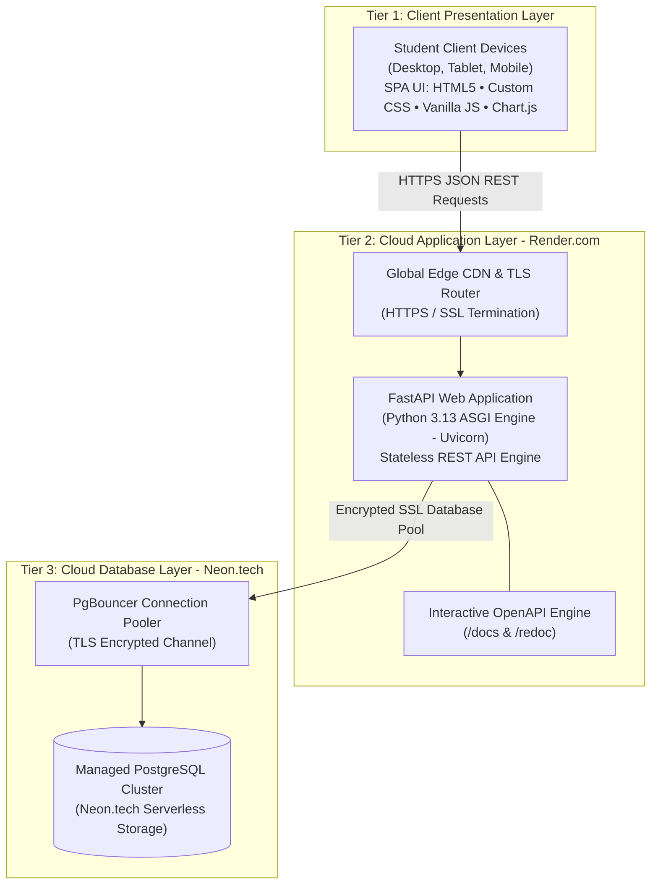

# CampusSpend — Cloud-Native Student Expense & Budget Tracker

> **BACSE344 — Cloud Infrastructure and Architecture (Digital Assignment)**  
> **Faculty:** Dr. P. Anandan | **Slot:** C1  
> **Author:** Sanskar (`s-nsk-r`) | **Registration No:** 25BCE5808 | **Course:** B.Tech CSE  
> **Live Web Application:** [https://campus-spend-cloud.onrender.com](https://campus-spend-cloud.onrender.com) *(or your deployed Render URL)*  
> **Interactive Swagger API Docs:** [https://campus-spend-cloud.onrender.com/docs](https://campus-spend-cloud.onrender.com/docs)  
> **Alternative ReDoc API Docs:** [https://campus-spend-cloud.onrender.com/redoc](https://campus-spend-cloud.onrender.com/redoc)

---

## 📌 Project Overview

**CampusSpend** is a production-grade, cloud-native expense management and budgeting platform designed specifically for university students. Engineered using a decoupled **3-Tier Cloud Architecture**, the application provides real-time financial tracking, multi-category budgeting, and visual spending analytics through a sleek, ACRU-inspired fintech bento-grid dashboard.

Deployed on **Render.com** (Cloud PaaS) with a managed **Neon.tech PostgreSQL** (Cloud DBaaS) backend, CampusSpend delivers automatic SSL termination, CI/CD pipeline automation, and connection pooling for scalable, low-latency performance.

---

## ✨ Key Features & Modern UI Capabilities

- **Bento-Grid Dashboard**: High-density financial dashboard presenting total spend, budget limits, remaining savings, and quick actions in an organized visual layout.
- **7-Category Stacked Bar Graph**:
  - Daily spending breakdown across all 7 student categories (*Food & Dining, Academics & Books, Transportation, Hostel & Utilities, Entertainment, Healthcare, Others*).
  - Engineered with custom **1px hairline category dividers** (zero lines at the baseline or peak) for a clean, modern aesthetic.
- **Dynamic Category Budget Scaling**:
  - Category budget limits automatically recalculate and scale proportionally whenever the overall monthly budget ceiling is updated.
- **Financial Health Radial Gauge**:
  - Real-time gauge displaying **Budget Used** percentage.
  - Automatically switches from signature lime-green to alert red if spending exceeds 100%, with unfilled budget clearly shown in neutral grey.
- **Segmented Cost Analysis Bar**:
  - Level, uncrooked segmented pill bar with crisp 2px slice spacing, providing an instant visual breakdown of expenditure.
- **Dual-Theme Engine**:
  - **Dark Mode**: Premium fintech aesthetic with deep black surfaces (`#111114`) and electric lime accents.
  - **Light Mode**: Crisp white surfaces with signature lime-green branding and high-contrast typography.
- **Custom Minimalist Scrollbars**: Replaces bulky browser scrollbars with sleek, thin sliders.
- **Multi-Device & Mobile Ready**: Full LAN and mobile support for managing campus expenses on phones, tablets, or laptops.

---

## 🏗️ 3-Tier Cloud Architecture



### Cloud Tiers Explained:
1. **Presentation Tier (Client)**: Lightweight, mobile-responsive SPA with asynchronous `fetch()` calls and instant DOM updates without full-page reloads.
2. **Application Tier (PaaS — Render.com)**: Stateless FastAPI application running Python 3.13 on Uvicorn with Pydantic request/response validation.
3. **Database Tier (DBaaS — Neon.tech)**: Serverless PostgreSQL cluster with connection pooling, automatic backups, and TLS encryption (`sslmode=require`), plus an offline SQLite fallback for local development.

---

## 💻 Tech Stack

| Domain | Technology | Purpose |
| :--- | :--- | :--- |
| **Backend Framework** | **FastAPI 0.141+** | High-performance asynchronous Python web framework |
| **Runtime & Server** | **Python 3.13 / Uvicorn** | ASGI web server running on Render cloud container |
| **ORM & Database** | **SQLAlchemy 2.0 / PostgreSQL** | Object Relational Mapping with connection pooling |
| **Data Validation** | **Pydantic v2** | Strict schema validation for incoming/outgoing payloads |
| **Cloud Hosting (PaaS)** | **Render.com** | Containerized Web Service with automated Git CI/CD |
| **Cloud Database (DBaaS)** | **Neon.tech** | Managed Serverless PostgreSQL with SSL/TLS |
| **Frontend UI** | **HTML5 / CSS3 / JavaScript** | Responsive bento grid, custom design tokens, zero build-step |
| **Data Visualization** | **Chart.js v4** | Interactive doughnut charts & stacked bar graph with custom canvas plugin |

---

## 🚀 Local Setup & Execution Guide

### Prerequisites
- Python 3.10+ (Python 3.13 recommended)
- Git installed on your system

### Installation Steps

1. **Clone the Repository:**
   ```bash
   git clone https://github.com/s-nsk-r/Campus-Spend.git
   cd Campus-Spend
   ```

2. **Create and Activate Virtual Environment:**
   ```powershell
   # Windows (PowerShell):
   python -m venv venv
   .\venv\Scripts\Activate.ps1

   # macOS / Linux:
   python3 -m venv venv
   source venv/bin/activate
   ```

3. **Install Dependencies:**
   ```bash
   pip install -r requirements.txt
   ```

4. **Run the Application:**
   ```bash
   python main.py
   # Or directly with uvicorn:
   uvicorn main:app --host 0.0.0.0 --port 8000 --reload
   ```

5. **Access in Your Browser:**
   - **Web Dashboard:** [http://localhost:8000](http://localhost:8000)
   - **Interactive API Docs (Swagger):** [http://localhost:8000/docs](http://localhost:8000/docs)
   - **ReDoc Documentation:** [http://localhost:8000/redoc](http://localhost:8000/redoc)
   - **Mobile Testing on Same Wi-Fi:** `http://<YOUR_LOCAL_IP>:8000`

---

## 🧪 Automated Testing & Verification

The project includes an automated test suite ([`test_app.py`](./test_app.py)) covering all API endpoints, CRUD workflows, aggregation calculations, and template rendering.

Run the test suite with:
```bash
python test_app.py
```

### Verification Results (11/11 Probes Passed):
```
==========================================
Testing CampusSpend Cloud REST API & CRUD
==========================================
[PASS] 1. Cloud Health Check Probe
[PASS] 2. Seed Sample Expense Data
[PASS] 3. Read All Expenses (Found records)
[PASS] 4. Category Filter Query (Found Food items)
[PASS] 5. CREATE Expense (ID: 13, Title: 'Cloud Computing Book')
[PASS] 6. READ Single Expense Details (ID: 13)
[PASS] 7. UPDATE Expense (New Amount: Rs.850.0)
[PASS] 8. Summary & Analytics API (KPI Aggregations)
[PASS] 9. DELETE Expense (Removed ID: 13)
[PASS] 10. Verify 404 on Deleted Record
[PASS] 11. HTML Web Dashboard & Template Rendering
==========================================
ALL 11 AUTOMATED VERIFICATION TESTS PASSED!
==========================================
```

---

## 📡 RESTful API Endpoints Summary

| Method | Endpoint | Description | Query / Body Params |
| :---: | :--- | :--- | :--- |
| `GET` | `/health` | Cloud health probe & service metadata | None |
| `GET` | `/` | Serves the main responsive Bento Web Dashboard | None |
| `GET` | `/api/expenses` | List all expenses with optional filters | `search`, `category`, `payment_method` |
| `POST` | `/api/expenses` | Create a new expense record | JSON: `title`, `amount`, `category`, `payment_method`, `notes` |
| `GET` | `/api/expenses/{id}` | Fetch a single expense by ID | Path: `id` |
| `PUT` | `/api/expenses/{id}` | Update existing expense fields | JSON: partial/full fields |
| `DELETE` | `/api/expenses/{id}` | Delete an expense record | Path: `id` |
| `GET` | `/api/summary/stats` | Compute real-time analytics KPIs | Aggregated JSON totals & breakdowns |
| `POST` | `/api/seed` | Seed realistic demo transactions | Instant evaluation utility |

---

## 📚 Complete Documentation Index

All supplementary submission documents are available in the [`/docs`](./docs) directory:

- 🏛️ **[System Architecture Document](./docs/ARCHITECTURE.md)** — Comprehensive 3-Tier cloud architecture details and diagrams.
- 🗄️ **[Database Design & Schema](./docs/DATABASE_DESIGN.md)** — Relational schema, ER diagrams, indexing strategies, and data dictionaries.
- 🔌 **[RESTful API Specification](./docs/API_DOCS.md)** — Detailed endpoint contracts, request/response models, and error statuses.
- ☁️ **[Cloud Deployment Guide](./docs/DEPLOYMENT_GUIDE.md)** — Step-by-step instructions for deploying to Render.com and Neon.tech DBaaS.
- 🎙️ **[Video Presentation Script](./docs/VIDEO_SCRIPT.md)** — Structured walkthrough script for project recording and demonstration.

---

## 📄 License & Attribution

Developed for **BACSE344 — Cloud Infrastructure and Architecture**, 2026.  
Author: **Sanskar** (`s-nsk-r`) | **Registration No:** 25BCE5808
