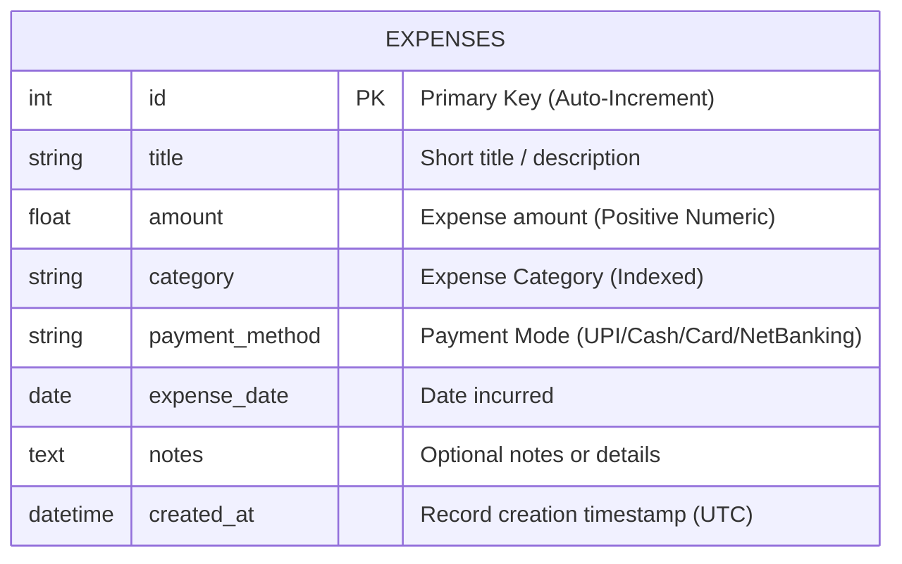

# Cloud Database Design & Schema Specification

**Course:** BACSE344 - Cloud Infrastructure and Architecture  
**Database System:** PostgreSQL 16 (Cloud DBaaS - Neon.tech) / SQLite fallback  
**ORM Layer:** SQLAlchemy 2.0  

---

## 1. Entity-Relationship (ER) Model



---

## 2. Data Dictionary & Table Schema

### Table Name: `expenses`

| Column Name | Data Type | Constraints | Default Value | Description |
| :--- | :--- | :--- | :--- | :--- |
| `id` | `INTEGER` / `SERIAL` | `PRIMARY KEY`, `NOT NULL` | Auto-incrementing | Unique record identifier |
| `title` | `VARCHAR(100)` | `NOT NULL`, `INDEXED` | None | Name/subject of the expense |
| `amount` | `FLOAT` / `NUMERIC(10,2)` | `NOT NULL`, `CHECK (amount > 0)` | None | Cost value in Currency (₹) |
| `category` | `VARCHAR(50)` | `NOT NULL`, `INDEXED` | None | Category grouping (Food, Books, Travel, etc.) |
| `payment_method` | `VARCHAR(50)` | `NOT NULL` | `'UPI'` | Payment instrument utilized |
| `expense_date` | `DATE` | `NOT NULL` | `CURRENT_DATE` | Date when expense occurred |
| `notes` | `TEXT` | `NULLABLE` | `NULL` | Additional remarks or vendor details |
| `created_at` | `TIMESTAMP` | `NOT NULL` | `CURRENT_TIMESTAMP` | Cloud audit timestamp |

---

## 3. SQL DDL Definition (PostgreSQL)

```sql
-- Production DDL for Cloud-hosted PostgreSQL (Neon.tech / Supabase)
CREATE TABLE IF NOT EXISTS expenses (
    id SERIAL PRIMARY KEY,
    title VARCHAR(100) NOT NULL,
    amount NUMERIC(10, 2) NOT NULL CHECK (amount > 0),
    category VARCHAR(50) NOT NULL,
    payment_method VARCHAR(50) NOT NULL DEFAULT 'UPI',
    expense_date DATE NOT NULL DEFAULT CURRENT_DATE,
    notes TEXT,
    created_at TIMESTAMP WITH TIME ZONE DEFAULT CURRENT_TIMESTAMP
);

-- Performance Optimization Indexes
CREATE INDEX IF NOT EXISTS idx_expenses_category ON expenses(category);
CREATE INDEX IF NOT EXISTS idx_expenses_date ON expenses(expense_date DESC);
CREATE INDEX IF NOT EXISTS idx_expenses_title ON expenses(title);
```
